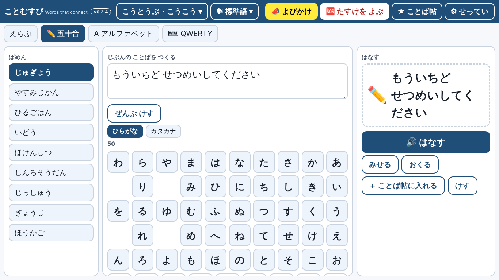

# ことむすび KOTOMUSUBI — Words that connect.

ことばを えらんで つたえる、音声出力コミュニケーションエイド（VOCA）の Web アプリです。
立場 → 場面 → 意図 → 表現 の順に選ぶと、端末が読み上げます。 toi toi toi（toitoitoi-lab）

公開先：https://toitoitoi-lab.github.io/kotomusubi/

## つくった理由
話すことが難しい人が、自分の意思を、自分で選んだことばで伝えられるようにするためです。
「言いたいことに近い表現」を、場面と意図から探せます。よく使うことばは「ことば帖」にまとめられます。

## v0.2 でできること
- 12 の立場・91 の場面・3,725 の表現（日本語／English、ひらがな／漢字／ふりがな）
- 端末に合わせた画面（デスクトップ・ラップトップ＝3 ペイン、タブレット＝2 ペイン、スマートフォン＝1 画面ずつ）
- 50音盤で自分のことばを作る「つくる」入力（予測・ことばタイル・だくてん・小もじ。作ったことばは記録しません）
- 読み上げ（ブラウザ標準の音声。よい声を自動で選び、設定で声を選べます）、確認画面、見せるモード、「おくる」（共有）
- ことば帖（複数作成・並べ替え・印刷）、JSON／CSV の書き出し・読み込み
- よびかけ（音と画面で注意を引く）、たすけを よぶ（登録した人へ電話・SMS・メール。長押しで確定）
- 大切な表現（強い「こまった」・相談窓口の表現）は、確認と長押しを必須にしています

## セットアップ
GitHub Pages で公開するだけで動きます（サーバー不要）。`index.html`、`data/`、`sw.js`、`manifest.webmanifest`、`icon.svg` を同じ場所に置いてください。
ファイルを直接開く場合は、辞書を内蔵した private 版を使ってください。

## 標準語・お国言葉（方言）
画面の上の「🗣」ボタン（または設定の「標準語・お国言葉」）で、標準語と、全国15地域のお国言葉（北海道弁・津軽弁・南部弁・仙台弁・茨城弁・名古屋弁・京ことば・大阪弁・播州弁・広島弁・土佐弁・博多弁・熊本弁・鹿児島弁・沖縄のことば）を切り替えられます。標準語に戻すときは、一覧の一番上の「標準語」を押します。

いまは「ためし」です。語尾や言い回しのきまりで自動的に置き換えているため、不自然なところがあるかもしれません。ていねいな言い方が、くだけた言い方になることもあります。置き換わった表現には「弁」の印が出ます。声は標準語のイントネーションで読みます。まだ地元の方の確認を受けていません。ご要望・まちがいは、設定の「ごようぼう・まちがいの おしらせは こちら」（GitHub の Issues）からお知らせください。

## プライバシー
入力した文・登録した相手・ことば帖は、この端末の中（localStorage）にだけ保存され、外部には送りません。
書き出したファイルの扱いは、利用する施設・学校の規程に従ってください。

## 大切な注意
ことむすびは**緊急通報サービスではありません**。24 時間見守りません。自動では通報しません。
ボタンを押したときだけ、登録した人に電話・SMS・メールの画面を開きます。

## 版
- v0.2.8（2026-10-13）：入力の種類（ひらがな／カタカナ／アルファベット）の切り替え、アルファベットの並び（ABC順／QWERTY）の切り替えを追加。
- v0.3.4（2026-10-14）：お国言葉の15地域すべてで、ことばが置き換わるようにした（語尾・言い回しのルールで自動変換。「ためし」）。置き換わった表現には「弁」の印が出る。「大切な ひょうげん」（困りごとの強いもの・相談窓口）は置き換えない。
- v0.3.3（2026-10-14）：「たちばを えらぶ」を、学校（小学部→中学部→高等部→専門学校・大学）、働く、暮らしの順に並べ、漢字にふりがなをつけた。お国言葉を選んでいるときは、上のボタンの色が変わる。
- v0.3.2（2026-10-13）：「ふつう」の言い方をやめ、「標準語・お国言葉」の表記に変更。
- v0.3.1（2026-10-13）：タイトルの横に「🗣 ことばの ちいき」ボタンを追加（設定を開かなくても、地域のことばを選べる）。
- v0.3.0（2026-10-13）：「ことばの ちいき」を追加。全国の代表的な15地域（北海道弁・津軽弁・南部弁・仙台弁・茨城弁・名古屋弁・京ことば・大阪弁・播州弁・広島弁・土佐弁・博多弁・熊本弁・鹿児島弁・沖縄のことば）を設定から選べる。いまは「ためし」（京ことば・大阪弁・播州弁・博多弁の一部）と「じゅんびちゅう」。地元の方の確認を受けてふやしていく。ごようぼう・まちがいの連絡先を設定に追加。
- v0.2.9（2026-10-13）：上のタブを「えらぶ｜五十音｜アルファベット｜QWERTY」（英語は Choose｜the Alphabet｜QWERTY）に作り替え。
- v0.2.7（2026-10-13）：英語版にアルファベット表（A–Z、左から右）を追加。英語の予測・ことばタイル。強さの見出しを「どのくらい つよく いう？」に変更。英語版の学年を Grade 表記に変更。
- v0.2.6（2026-10-13）：50音盤を右から左（あ行が右）に変更。「つよさ」を「つたえかた（やわらかく／ふつう／はっきり）」に変更。
- v0.2.5（2026-10-13）：「つよさ」を「いいかたの つよさ」に改め、● の意味の説明を追加。
- v0.2.4（2026-10-13）：アプリのタイトルの横に版（v0.2.4）を表示。
- v0.2.3（2026-10-13）：更新したときに、新しい画面がすぐ出るように変更（画面はネット優先）。
- v0.2.2（2026-10-13）：読み上げの声の選び方を見直し（ロボット声・かすれ声を避ける）。設定に「いま つかう 声」を表示。
- v0.2.1（2026-10-13）：配色に「黒×水色」を追加。ハイコントラストの「はなす」の文字を黒に修正し、黄（水色）が占める面積を減らした。
- v0.2（2026-10-13）：「つくる」入力と 50音盤、予測、ことばタイル、声の選択。
- v0.1（2026-10-12）：画面の骨格、モード A（選ぶ）、音声、ことば帖、よびかけ、おくる、たすけを よぶ、書き出し・読み込み。
- 次の版：印刷プリセット、QR、アイコン差し替え、「すこし変える」。

